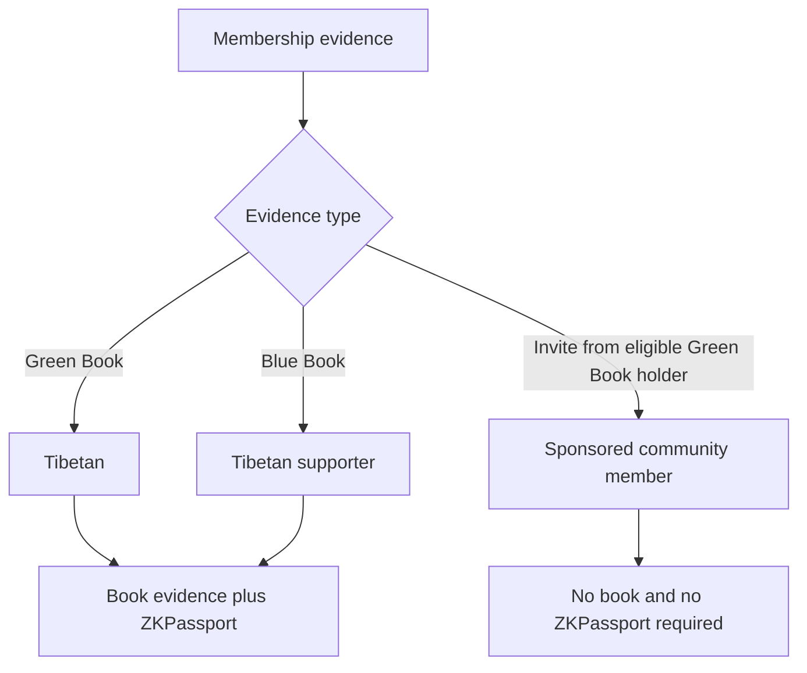
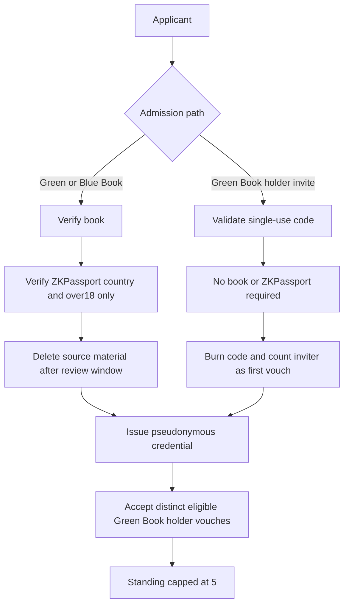
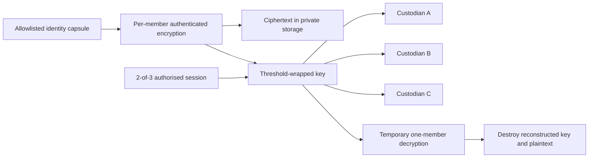
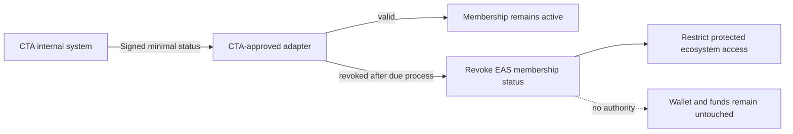
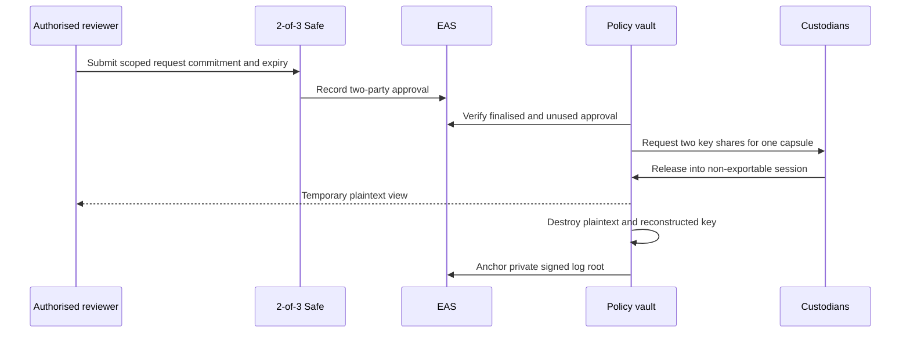
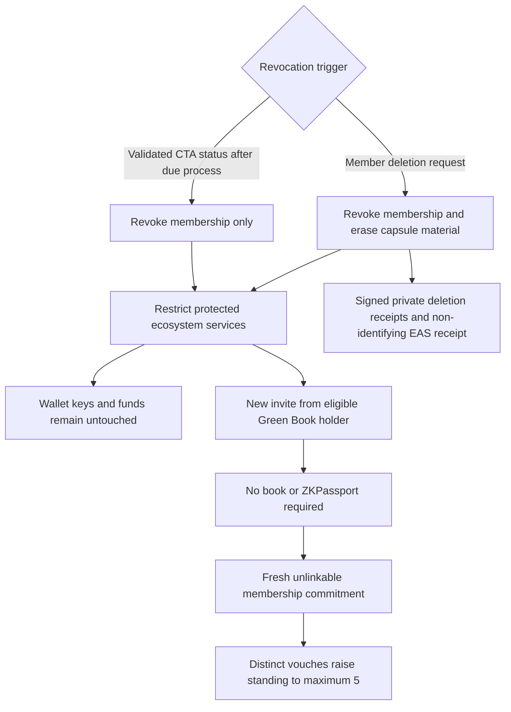

# Tibetan ID

Privacy-preserving membership architecture for the New Tibet ecosystem.

> [!IMPORTANT]
> This is a concept and code-level specification for foundation, CTA, privacy, legal, and security review. It is not a production system or a claim of regulatory compliance. Mermaid diagrams and the policy examples below are source code; production rules must also be enforced by contracts and automated tests.

## Contents

1. [Background: Green Books and Blue Books](#1-background-green-books-and-blue-books)
2. [Membership rules](#2-membership-rules)
3. [Admission and community standing](#3-admission-and-community-standing)
4. [The identity capsule](#4-the-identity-capsule)
5. [Onchain state and future CTA integration](#5-onchain-state-and-future-cta-integration)
6. [Exceptional access](#6-exceptional-access)
7. [Deletion and re-entry](#7-deletion-and-re-entry)
8. [Implementation work](#8-implementation-work)
9. [References](#9-references)

## 1. Background: Green Books and Blue Books

The two books represent different relationships with the Tibetan community:

- **Green Book - Tibetans.** The Central Tibetan Administration (CTA) Department of Finance maintains the Green Book system for Tibetans and records voluntary contributions. The CTA's digital portal supports applications for new, modified, lost, and additional Green Books, with review by a Tibetan Settlement Office and the Department of Finance.
- **Blue Book - Tibetan supporters.** The CTA describes the Blue Book as the Tibetan Solidarity Partnership. Introduced in 1996 and patterned after the Green Book, it records contributions by friends and supporters of Tibet.

For this architecture, a verified Green Book supports the `TIBETAN` membership class and a verified Blue Book supports the `SUPPORTER` class. A Green Book holder may also sponsor another person through the separate invitation path. That invitation proves community sponsorship; it does not claim that the invited person personally holds either book.

New Tibet is not presented as part of the CTA, and this repository does not imply CTA endorsement. Any future connection to CTA systems would require CTA agreement, a documented interface, and independent privacy and security review.



## 2. Membership rules

The implementation must preserve these invariants:

```typescript
const policy = {
  bookPathRequires: ["verified_green_or_blue_book", "zkpassport_proof"],
  invitePathRequires: ["unused_invite_from_eligible_green_book_holder"],
  zkPassportRecord: ["country", "over18"], // exactly these two outputs
  maxStanding: 5,
  deletionAffects: ["membership", "protected_ecosystem_access"],
  deletionNeverAffects: ["wallet_keys", "token_balances", "fund_transfers"],
} as const;
```

The ZKPassport record contains the proved **country** and whether the person is **over 18**, and nothing else. It must not record a name, exact date of birth, document number, address, photograph, or raw passport data. On the book path this proof is additional to - never a substitute for - Green or Blue Book evidence.

```typescript
expect(admit({ book: "green", zk: { country: "IN", over18: true } })).toAccept();
expect(admit({ book: "blue",  zk: { country: "GB", over18: true } })).toAccept();
expect(admit({ book: "green", zk: undefined })).toReject();
expect(admit({ invite: "valid-green-holder-code", book: undefined, zk: undefined })).toAccept();
expect(standing({ distinctEligibleGreenBookVouchers: 9 })).toBe(5);
```

## 3. Admission and community standing

### 3.1 Book path

1. An authorised reviewer verifies a Green or Blue Book.
2. The applicant provides a ZKPassport proof containing only `country` and `over18`.
3. The reviewer checks both results and approves or rejects the application.
4. Source photos, uploads, and temporary proof material are deleted after the approved review and appeal window.
5. The system issues a pseudonymous membership credential and EAS status attestation.

### 3.2 Green Book holder invitation path

1. An eligible Green Book holder creates a single-use, expiring invite code.
2. The applicant redeems it without presenting a Green Book, Blue Book, or ZKPassport proof.
3. The system validates the issuer, burns the code, and records the issuer's first vouch through a pairwise nullifier.
4. The system issues a sponsored membership credential.

### 3.3 Standing

Each additional vouch must come from a distinct eligible Green Book holder. The same holder cannot increase the same member's standing twice. Standing is `min(distinct active vouches, 5)` and is only a bounded community signal; it is not proof of legal identity or control of funds.



## 4. The identity capsule

The identity capsule is a small, encrypted, per-member record used only when the system must recover the basis for a membership decision. It is not a document archive and must not contain book photographs, book numbers, passport data, exact dates of birth, or ordinary wallet addresses.

Its base schema is deliberately allowlisted:

```typescript
type ZKPassportRecord = Readonly<{
  country: string; // ISO 3166 country code proved by ZKPassport
  over18: boolean;
}>;

type AdmissionEvidence =
  | Readonly<{
      kind: "green_book" | "blue_book";
      verificationResult: "verified";
      verifiedAt: string;
      zkPassport: ZKPassportRecord; // no other ZKPassport fields permitted
    }>
  | Readonly<{
      kind: "green_book_holder_invite";
      inviteReceiptCommitment: string;
      // no book evidence and no ZKPassport record
    }>;

type IdentityCapsule = Readonly<{
  version: 1;
  privateMemberId: string; // random 256-bit value; never an email or wallet
  membershipClass: "TIBETAN" | "SUPPORTER" | "SPONSORED";
  admission: AdmissionEvidence;
  activeVouchReceiptCommitments: readonly string[]; // maximum five counted
  createdAt: string;
  policyVersion: string;
}>;
```

Contact details or other legally required personal data are not part of the base capsule. If a reviewed use case genuinely requires them, they belong in a separately encrypted, purpose-limited extension with its own retention deadline.

### 4.1 Storage and custody

1. Generate a fresh random data-encryption key for each capsule.
2. Encrypt the serialised capsule with an authenticated cipher such as AES-256-GCM or XChaCha20-Poly1305.
3. Store only ciphertext in private object storage.
4. Split or threshold-wrap the data-encryption key across three independently governed custodians: the New Tibet Foundation, a Tibetan institution, and an independent security trustee.
5. Require any two custodians for one member-specific, time-limited reconstruction.
6. Never place the storage location, key shares, plaintext, or identifying fields onchain.



## 5. Onchain state and future CTA integration

[Ethereum Attestation Service (EAS)](https://attest.org/) is the public integrity and revocation layer, not an identity database. EAS receives only high-entropy commitments, status, standing, policy versions, and audit roots.

```text
MembershipStatus:
bytes32 memberCommitment, uint8 state, uint8 standing, bytes32 policyVersion, bytes32 capsuleCommitment

Vouch:
bytes32 memberCommitment, bytes32 voucherNullifier, bytes32 policyVersion

AccessApproval:
bytes32 requestCommitment, uint64 validUntil, bytes32 policyVersion

AuditAnchor:
bytes32 logRoot, bytes32 policyVersion

DeletionReceipt:
bytes32 erasureCommitment, bytes32 policyVersion
```

No EAS attestation may contain names, contact details, wallet-to-person mappings, book or passport numbers, images, invite codes, raw ZK proofs, country, age status, or private-storage locations. The capsule commitment must be strongly salted so it cannot be used to guess capsule contents.

### 5.1 Possible CTA integration

A future, CTA-approved adapter could query or receive a signed result from the CTA's internal Green/Blue Book system. The minimal response should be an opaque subject reference plus `valid`, `revoked`, or `unknown`; it should not copy the CTA record into New Tibet.

A verified CTA revocation could revoke or restrict the corresponding New Tibet membership credential and EAS attestation after the agreed due-process and appeal rules run. It must never freeze funds. The adapter must have authority over the membership registry only and must hold no role, allowance, or upgrade power in token or treasury contracts.

```solidity
interface IMembershipRegistry {
    function revoke(bytes32 memberCommitment, bytes32 reasonCommitment) external;
}

contract CTAStatusAdapter {
    IMembershipRegistry public immutable membershipRegistry;

    // Called only after authenticating a CTA-approved signed status response.
    function applyCTARevocation(
        bytes32 memberCommitment,
        bytes32 reasonCommitment
    ) external onlyAuthorisedCTAOracle {
        membershipRegistry.revoke(memberCommitment, reasonCommitment);
        // Intentionally no token, wallet, treasury, transfer, or freeze call.
    }
}
```



EAS history is immutable, so a revoked attestation remains visible as pseudonymous history. This is why identifying data and the two ZKPassport outputs stay offchain inside the encrypted capsule.

## 6. Exceptional access

Private capsule access requires a member-specific purpose, narrow scope, expiry, two independent approvals through a dedicated 2-of-3 Safe, and enforcement by a policy-aware vault or HSM. EAS records only a random request commitment and audit-log root.



A Safe transaction proves approval, not correct viewing. HSM enforcement, non-exportable shares, per-record controls, and signed private logs remain mandatory.

## 7. Deletion and re-entry

An authenticated member may request deletion without a custodian vote or Safe approval. The system closes active capsule sessions, cryptographically erases keys and backups, deletes shares and indexes, and revokes membership access.

Deletion or a future CTA-triggered membership revocation:

- restricts login, eligibility, voting, governance, and other services that require active membership;
- does not freeze, seize, move, burn, or lock funds;
- does not revoke wallet keys or call token contracts.

The former member may re-enter through a new invite from an eligible Green Book holder. This requires no Green Book, Blue Book, or ZKPassport proof from the returning person. Re-entry creates a fresh, unlinkable member secret and commitment, and the inviter supplies the first vouch.

```typescript
expect(await deleteMembership(member)).not.toCall(token.transferFrom);
expect(await deleteMembership(member)).not.toCall(token.freeze);
expect(await deleteMembership(member)).toRevoke("protected_ecosystem_access");

expect(await reenter({ validGreenBookHolderInvite: true }))
  .toRequire({ book: false, zkPassport: false })
  .and.toIssue({ freshMemberCommitment: true, standing: 1 });
```



## 8. Implementation work

Before launch, the project needs executable contracts and tests for every invariant above, a formal threat model, final EAS schemas and resolver rules, chain selection, anonymous credential design, CTA and custodian agreements, appeal and recovery policies, retention schedules, a privacy impact assessment, and independent legal and security reviews.

## 9. References

- [CTA: Green Book Online Application Portal](https://tibet.net/official-announcement-department-of-finance-launches-green-book-online-application-portal/)
- [CTA: Greenbook Digital Portal](https://greenbook.tibet.net/)
- [CTA: Friends of Tibet and the Blue Book](https://tibet.net/support-tibet/friends-of-tibet/)
- [GitHub documentation: Mermaid diagrams in Markdown](https://docs.github.com/en/get-started/writing-on-github/working-with-advanced-formatting/creating-diagrams)
- [Ethereum Attestation Service contracts](https://github.com/ethereum-attestation-service/eas-contracts)
- [ZKPassport](https://zkpassport.id/)
