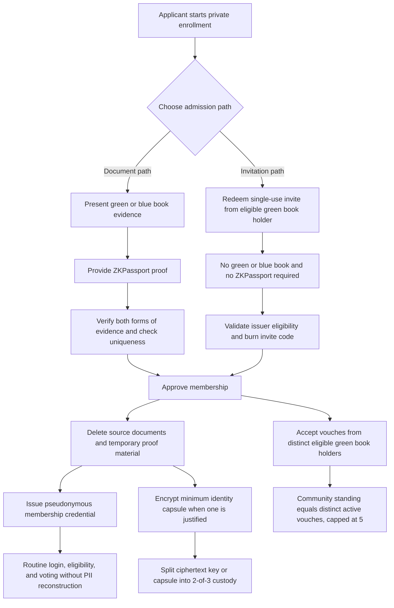
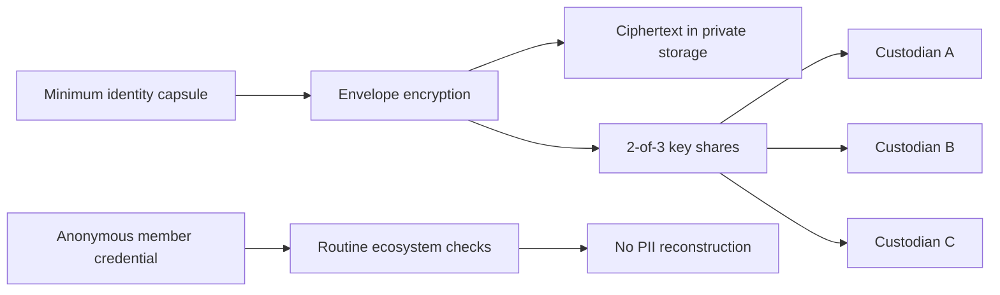
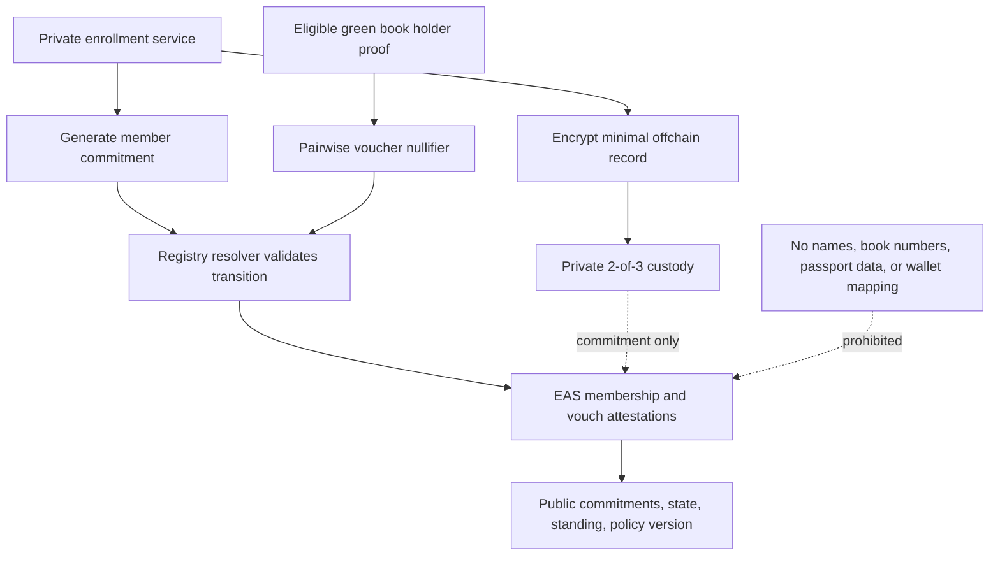
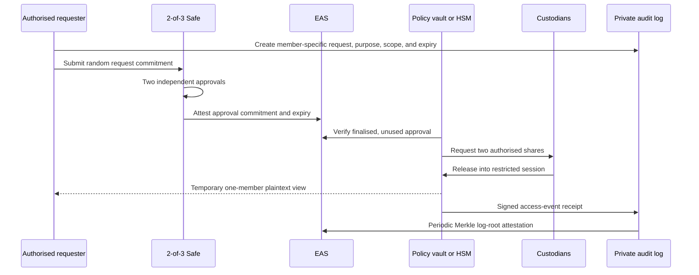
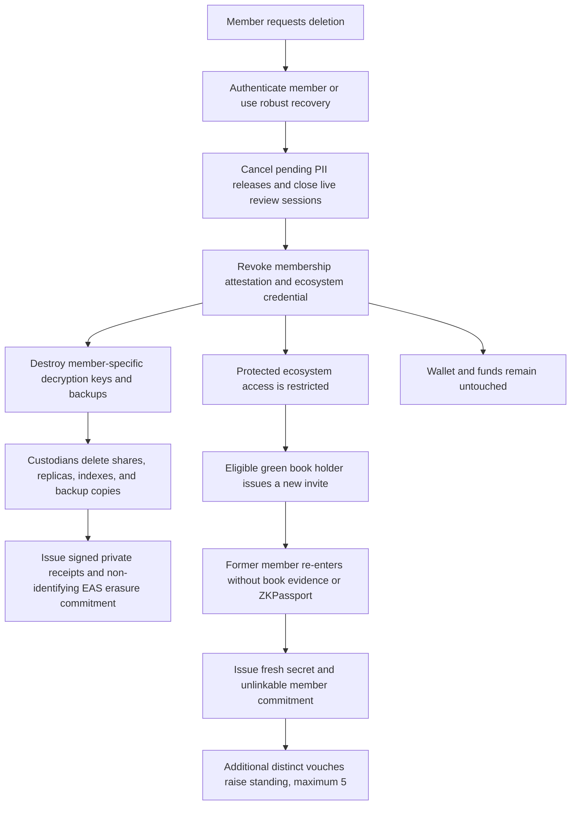

# Tibetan ID

Privacy-preserving membership architecture for the New Tibet ecosystem.

> [!IMPORTANT]
> This is a concept architecture for foundation, privacy, legal, and security review. It is not a production specification or a claim of regulatory compliance.

## Goals

- Verify eligibility without maintaining a central identity database.
- Keep routine membership checks unlinkable to the member's source documents.
- Put only pseudonymous commitments, state, and audit anchors onchain.
- Require recorded, time-limited approval for exceptional access to identity data.
- Let a member request deletion without freezing or taking custody of their funds.
- Let distinct eligible green book holders build a member's community standing through vouches, capped at five.

## Admission paths

There are two separate ways to become a member.

### 1. Green or blue book plus ZKPassport

The document path requires both:

1. evidence from a Tibetan green book or blue book; and
2. a valid [ZKPassport](https://zkpassport.id/) proof.

The ZKPassport proof is **in addition to**, not a replacement for, the green or blue book. It can prove narrowly requested properties such as document authenticity, personhood, or uniqueness without disclosing the underlying government identity document. It does not itself prove Tibetan eligibility.

After an authorised reviewer confirms the combined evidence, source photographs and temporary uploads are deleted. Only the minimum justified identity capsule is retained under encrypted 2-of-3 custody.

### 2. Green book holder invitation

A person may instead redeem a single-use, expiring invite code issued by an eligible green book holder. This path requires **neither a green or blue book nor a ZKPassport proof** from the invited person. The issuer's eligibility and the code's validity are checked; the code is then burned and deleted.

The issuer's sponsorship counts as the invited member's first vouch. Additional distinct eligible green book holders may vouch for the member. Each holder can count only once for the same member, and community standing is capped at five vouches.

Standing is a bounded community signal, not proof of legal identity, ownership of funds, or permission for custodians to reveal personal information.



## Privacy and custody architecture

Routine membership does not require reconstructing personal information. A member proves control of a secret associated with an opaque member commitment and presents a current anonymous credential or zero-knowledge membership proof.

If a minimum identity capsule is legally or operationally necessary, it is encrypted before storage. The decryption material is split across three independently governed custodians:

- A: New Tibet Foundation
- B: a Tibetan institution
- C: an independent security trustee

Any two shares can reconstruct access for one authorised, member-specific session. One compromised custodian cannot do so alone. Two colluding custodians remain a material threat, so shares must be non-exportable where possible, access must be enforced by policy-aware HSM or vault infrastructure, and every reconstruction must produce a signed audit event.



## Onchain records with Ethereum Attestation Service

[Ethereum Attestation Service (EAS)](https://attest.org/) provides a schema registry and an attestation contract. This architecture uses revocable EAS attestations as a public integrity and status layer, not as an identity database. A resolver or registry contract should enforce authorised issuers, valid state transitions, unique vouchers, and the five-vouch cap.

The production chain is a deployment decision. Start on a testnet and record the selected chain, EAS contract address, schema UIDs, resolver address, and governance owner before launch.

### Conceptual schemas

The exact ABI schemas should be finalised during implementation. A minimal starting point is:

```text
MembershipStatus:
bytes32 memberCommitment, uint8 state, uint8 standing, bytes32 policyVersion, bytes32 offchainRecordCommitment

Vouch:
bytes32 memberCommitment, bytes32 voucherNullifier, bytes32 policyVersion

AccessApproval:
bytes32 requestCommitment, uint64 validUntil, bytes32 policyVersion

AuditAnchor:
bytes32 logRoot, bytes32 policyVersion

DeletionReceipt:
bytes32 erasureCommitment, bytes32 policyVersion
```

Suggested state values are `1 = active`, `2 = restricted`, and `3 = revoked`. In EAS, the active status attestation should be revocable. A state or standing change revokes the current attestation and issues a successor under the same policy. EAS history is immutable, so deletion cannot erase a past transaction; privacy depends on never putting identifying data into that transaction.

### What is stored onchain

- A random-looking member commitment derived from a member secret with domain separation and strong entropy.
- Active, restricted, or revoked membership state.
- Standing from 0 to 5.
- Pairwise voucher nullifiers that let a resolver reject a second vouch from the same eligible green book holder for the same member without publishing the holder's identity.
- Policy versions, random request commitments, and Merkle roots of private audit logs.
- Revocations and non-identifying erasure receipts.

The EAS attester should be a registry contract or privacy-preserving relayer rather than the member's ordinary wallet. Use a neutral recipient where the deployment supports it so the attestation does not create a public wallet-to-member link. Eligibility proofs and resolver logic must ensure that only an authorised green book holder can create a valid vouch.

### What must never be stored onchain

- Names, birth dates, addresses, emails, phone numbers, photographs, or document numbers.
- Green or blue book images or numbers.
- Passport data, ZKPassport source data, or selectively disclosed identity attributes that are not strictly necessary.
- Wallet-to-person mappings.
- Invite codes or hashes of guessable or low-entropy personal data.
- Storage URLs, object keys, or content identifiers that reveal or enable discovery of private records.



## Exceptional access to private identity data

Exceptional access is allowed only for a specific member, justified purpose, narrow scope, and short time window.

1. Create an access request in the private audit system.
2. Two independent custodians approve it through a dedicated 2-of-3 Safe.
3. Put only a random request commitment and expiry onchain as an EAS `AccessApproval` attestation. Never put the member reference, reason, or PII onchain.
4. A policy-enforcing vault or HSM verifies finalised approval, scope, expiry, and one-use status.
5. Two custodians release shares into a restricted, non-exportable session.
6. The authorised reviewer receives temporary plaintext access for that member only.
7. Close the session, discard plaintext and reconstructed keys, sign an access-event receipt, and periodically anchor the private log's Merkle root through EAS.

A Safe transaction proves that access was authorised; it does not prove that the vault enforced the scope or that plaintext was actually viewed. HSM enforcement, non-exportable shares, per-record controls, and tamper-evident logs are therefore essential.



## Member-controlled deletion and re-entry

An authenticated member may request deletion without a custodian vote or Safe approval. A robust lost-wallet recovery path must also exist.

Deletion deliberately separates **membership access** from **asset control**:

- It does **not** freeze, seize, move, burn, or lock the member's funds.
- It does **not** revoke the member's wallet keys or call token contracts.
- Existing funds remain under the user's control and remain transferable wherever the underlying asset permits it.
- It does revoke or restrict the membership credential, so applications that require active membership must deny login, eligibility, voting, governance, or other protected Tibetan ecosystem services.

The system then destroys the member-specific decryption key and backups, instructs all custodians to delete shares, replicas, indexes, and backup copies, and issues signed erasure receipts. Any lawful retention exception must be documented. Previously disclosed or copied information cannot be recalled.

To regain access after deletion, the former member uses the invitation/vouch path through an eligible green book holder. That re-entry path does not require the former member to present a green or blue book or a ZKPassport proof. It issues a fresh member secret and commitment; the inviter supplies the first vouch, and further distinct green book holders can increase standing up to five.



## Data lifecycle

| Data | Location | Retention rule |
| --- | --- | --- |
| Green or blue book photo | Temporary encrypted review area | Delete after the review and appeal window unless law requires otherwise |
| ZKPassport proof material | Transient verifier memory or short-lived encrypted evidence store | Keep only the minimum audit result; do not retain source identity data |
| Invite code | Private invite service | Single use, short expiry, delete after redemption or expiry |
| Minimal identity capsule | Encrypted private storage with 2-of-3 custody | Keep only while justified; cryptographically erase on valid deletion |
| Membership status | EAS | Pseudonymous and revocable; past chain history cannot be erased |
| Vouch state | EAS plus private anti-abuse service where needed | Pairwise nullifier and capped count only; no public social graph |
| Access details | Private tamper-evident audit log | Retain under an approved schedule; anchor only a Merkle root onchain |
| Deletion evidence | Signed private receipts plus EAS commitment | No identifying information in the public receipt |

## Security and governance requirements

- Complete a privacy impact assessment and independent security review before launch.
- Specify lawful bases, retention periods, appeal handling, and jurisdiction-specific obligations.
- Separate enrollment, attestation, custody, and application-gating duties.
- Use threshold controls for administration and schema-resolver upgrades.
- Rotate custodian keys and test recovery without using real member data.
- Rate-limit invites and vouches; detect coercion, sale, collusion, and compromised green book holder credentials.
- Make standing rules transparent and provide a private correction or appeal process.
- Ensure deletion is idempotent, observable to the member, and covered by backup-erasure procedures.
- Treat public-chain metadata, timing, gas sponsorship, and relayer logs as privacy-sensitive.

## Implementation status

This repository currently documents the target architecture. Before implementation, the project still needs a formal threat model, final EAS schemas and resolver rules, chain selection, anonymous credential design, custodian agreements, retention schedule, recovery policy, and independent legal and security review.

## References

- [GitHub documentation: Mermaid diagrams in Markdown](https://docs.github.com/en/get-started/writing-on-github/working-with-advanced-formatting/creating-diagrams)
- [Ethereum Attestation Service contracts](https://github.com/ethereum-attestation-service/eas-contracts)
- [Ethereum Attestation Service schema concepts](https://github.com/ethereum-attestation-service/eas-docs-site/blob/main/docs/core--concepts/schemas.md)
- [ZKPassport](https://zkpassport.id/)
