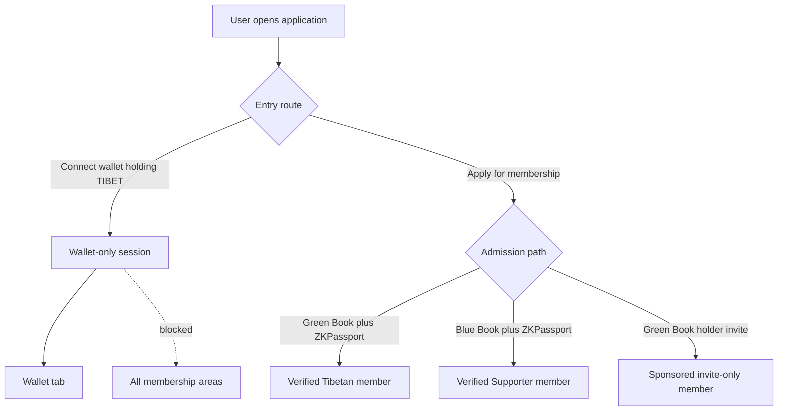
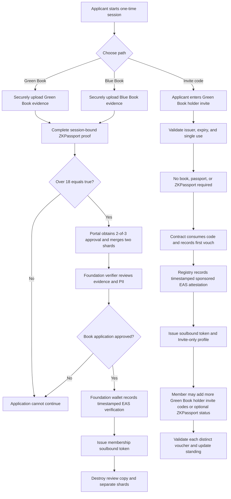
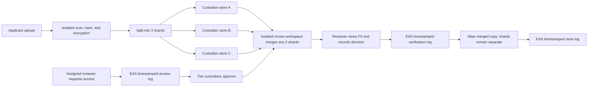
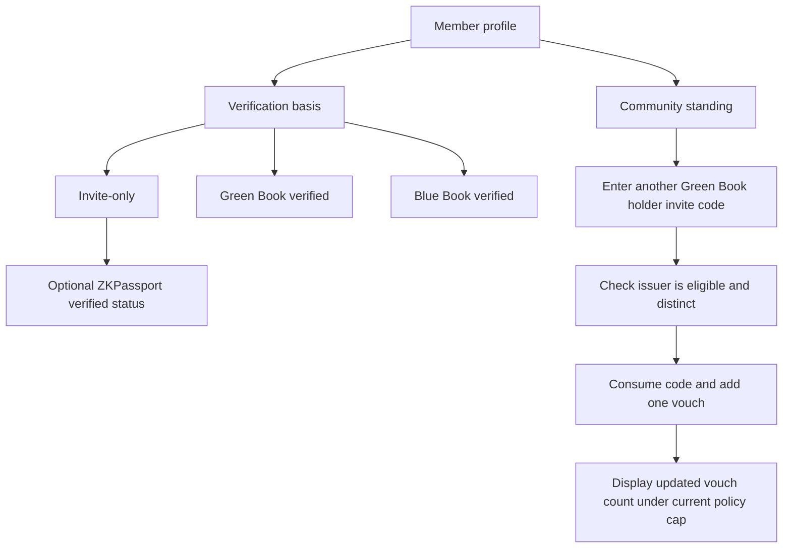
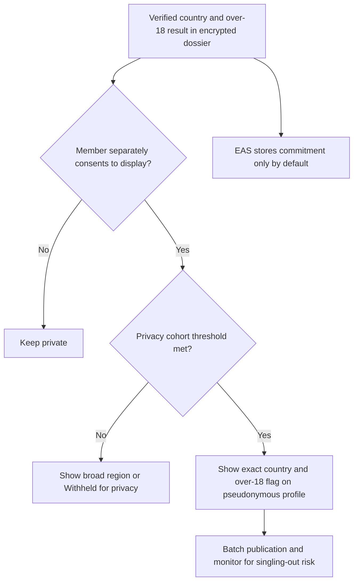
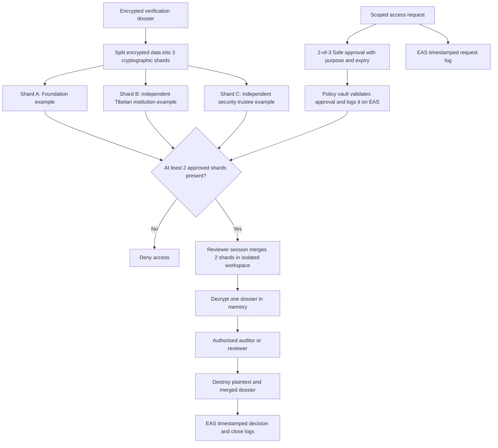

# Tibetan ID

Privacy-preserving access and membership architecture for the New Tibet ecosystem.

> [!IMPORTANT]
> This is a concept architecture for privacy, legal, governance, and security review. It is not yet a production specification.

## Contents

1. [User types and access](#1-user-types-and-access)
2. [Green Books, Blue Books, and proof of personhood](#2-green-books-blue-books-and-proof-of-personhood)
3. [Admission paths](#3-admission-paths)
4. [Foundation Verification Portal](#4-foundation-verification-portal)
5. [Encrypted verification dossier](#5-encrypted-verification-dossier)
6. [Vouches and trust levels](#6-vouches-and-trust-levels)
7. [Onchain records and public attributes](#7-onchain-records-and-public-attributes)
8. [Threshold custody and exceptional access](#8-threshold-custody-and-exceptional-access)
9. [Future CTA integration](#9-future-cta-integration)
10. [Deletion, revocation, and re-entry](#10-deletion-revocation-and-re-entry)
11. [Implementation work](#11-implementation-work)
12. [References](#12-references)

## 1. User types and access

Tibetan ID separates holding the `$TIBET` coin from being a verified or sponsored member.

| User type | How they enter | Access |
| --- | --- | --- |
| `$TIBET` coin holder | Connects a wallet that holds `$TIBET` | **Wallet tab only.** No membership areas, profile verification, voting, member directory, invite creation, or vouching. |
| Sponsored member | Redeems an invite from an eligible Green Book holder | Membership access allowed by the current ecosystem policy; profile remains marked `Invite-only`. |
| Green Book verified member | Passes Green Book, ZKPassport, and Foundation verification | Tibetan membership class plus any community vouches. |
| Blue Book verified member | Passes Blue Book, ZKPassport, and Foundation verification | Supporter membership class plus any community vouches. Cannot invite or vouch. |

A wallet-only user is not treated as a member merely because they hold tokens. Membership revocation or deletion also remains separate from asset ownership: it can remove protected ecosystem access but cannot freeze or move the user's funds.

A wallet-only user may later apply through any membership path, but retains only Wallet-tab access until a membership credential is issued.

## 2. Green Books, Blue Books, and proof of personhood

- **Green Book - Tibetans.** The Central Tibetan Administration (CTA) Department of Finance maintains the Green Book system for Tibetans and records voluntary contributions.
- **Blue Book - Tibetan supporters.** The CTA describes the Blue Book as the Tibetan Solidarity Partnership, introduced in 1996 for friends and supporters of Tibet.

Within Tibetan ID, Green Book holders and Blue Book holders may both be verified as members. Only a currently eligible Green Book holder may issue invite codes or provide vouches. A Blue Book holder cannot invite or vouch for another person.

### 2.1 Why ZKPassport is added

The book process depends partly on uploaded images and human review. Those materials may be forged, altered, borrowed, or generated with AI, and the Green Book and Blue Book systems do not have the same cryptographic document infrastructure as modern NFC passports.

ZKPassport is therefore used as an additional **proof-of-personhood signal**. It verifies the cryptographic signature of a supported NFC passport or identity document and can prove selected facts without exposing the source document. This reduces the chance that a completely synthetic or AI-generated applicant passes the book process.

It does not prove that the Green Book or Blue Book is genuine, and it does not by itself prove that the book belongs to the passport holder. The Foundation verifier must still assess the book evidence and bind the book submission and ZKPassport proof to the same one-time application session. Suspicious cases require step-up review.

It should also not be treated as an absolute guarantee of one-human-one-account. Replay, renewal, and multiple-document risks require separate nullifier and duplicate-account controls.

The retained ZKPassport results are limited to:

- a successful proof-of-personhood result;
- country; and
- whether the applicant is over 18.

No name, exact date of birth, passport number, address, photograph, or raw passport data is received from ZKPassport.

Tibetan ID is an 18+ application. On a ZKPassport path, the proof must return `over 18 = true`; a false, missing, or failed result stops the application. Invite-only applicants must declare that they are 18 or older because they are not required to use ZKPassport. This cannot guarantee that every applicant is an adult, but any later ZKPassport result showing that the person is not over 18 prevents them from continuing as a member.

## 3. Admission paths

### 3.1 Green Book or Blue Book path

1. The applicant creates a one-time application session.
2. The applicant securely uploads the Green Book or Blue Book information required for review. The portal encrypts it and separates it into three shards.
3. The applicant completes a ZKPassport proof bound to the same session. The application continues only when `over 18 = true`.
4. The verifier opens an assigned case; after 2-of-3 approval, the portal temporarily merges two shards inside the isolated review session so the verifier can view the PII.
5. The verifier reviews the book evidence and proof-of-personhood result, then approves, rejects, or requests step-up review.
6. If approved, a trusted Foundation wallet records the verification and its timestamp in EAS. A non-transferable membership soulbound token is issued to the applicant's chosen membership wallet.
7. The review session is destroyed and the dossier returns to separately held shards.

### 3.2 Green Book holder invitation path

1. An eligible Green Book holder creates a single-use, expiring invite code.
2. The applicant enters the invite code.
3. The service verifies that the issuer is a currently eligible Green Book holder and that the code is unused and unexpired.
4. The applicant does not need a Green Book, Blue Book, passport, or ZKPassport proof.
5. The code is consumed, the inviter supplies the first vouch, and the profile is marked `Invite-only`.
6. The membership registry automatically records the sponsored EAS attestation and timestamp and issues the soulbound token. Foundation review or approval is not involved.
7. The member may later add more distinct Green Book holder invite codes or optionally add ZKPassport-verified status.

This path is important for Tibetans who need to remain anonymous, may face personal or political risk if they upload book-linked information, do not have a passport, or do not have access to a compatible NFC document or device. It creates a community-supported route into the application without publicly asserting a government or book-backed identity.

An invite-only profile can later submit additional invite codes from other distinct, eligible Green Book holders. Each valid additional code becomes another vouch and strengthens the member's web-of-trust standing.

## 4. Foundation Verification Portal

The **Foundation Verification Portal** is a dedicated, self-hosted case-review application under Foundation control. It has an applicant upload page, three independently administered shard stores, and an isolated reviewer workspace. It is not the public member application, a cloud drive, or a third-party KYC dashboard.

### 4.1 Concrete review flow

1. The public application obtains a short-lived case ID and expiring upload link.
2. An isolated ingestion worker scans the upload, hashes it, encrypts it, splits it into three cryptographic shards, writes each shard to a different custodian store, and erases the complete ingestion copy.
3. A reviewer signs in with a hardware-backed credential and opens an assigned case. The portal writes a PII-free, timestamped `review requested` event to EAS.
4. After two custodians approve, the reviewer's session causes the isolated workspace to retrieve and merge two shards in memory. Only then can the reviewer see the book PII, file metadata, ZKPassport receipt, tamper warnings, and prior permitted decisions.
5. The reviewer approves, rejects, requests clearer evidence, or escalates to a second reviewer. EAS records the case commitment, outcome, policy version, verifier commitment, `verifiedAt` timestamp, and attestation time - never the PII.
6. Closing the session wipes the merged data and records a timestamped `review closed` event on EAS. The three stored shards remain separate.

### 4.2 Safeguards

- Named least-privilege reviewer accounts, hardware keys or passkeys, no shared accounts, and rapid offboarding.
- A view-only, watermarked workspace with short sessions; download, print, clipboard, and export disabled by default.
- TLS, per-case encryption, independent shard administration, encrypted backups, rotation, and tested erasure.
- No trackers, advertising analytics, PII in operational logs, consumer scanning services, or model training with evidence.
- Every access, reconstruction, decision, export, and closure logged onchain using high-entropy case commitments and timestamps, without PII.
- Two-person approval for suspicious cases or exports, trained reviewers, access reviews, incident response, processor agreements, and fixed retention periods.

## 5. Encrypted verification dossier

The earlier minimal identity-capsule concept is insufficient for later fraud review. An auditor cannot judge whether a book was forged from only a membership class and approval timestamp. It is replaced by an **encrypted verification dossier** that preserves enough evidence to reconstruct and audit the decision while keeping it outside the public chain.

### 5.1 Dossier contents

- Original uploaded Green Book or Blue Book files in the submitted format.
- Cryptographic hashes, upload timestamps, file metadata, and chain-of-custody events.
- Book type and the fields necessary for verification, such as the visible holder details, book identifier, issuing office, status markers, and other authenticity indicators actually present on the document.
- ZKPassport verification receipt: successful proof of personhood, country, over-18 result, session challenge, verification time, and verifier or circuit version. No raw passport data.
- Reviewer identity, review times, reason codes, notes, fraud indicators, and any second-review decision.
- The final membership class, policy version, `submittedAt` and `verifiedAt` times, EAS attestation UID, and soulbound-token ID.
- Book-verification revocation, correction, and appeal history.
- Step-up review material only when necessary, separately labelled and given a shorter retention period where possible.

### 5.2 Why it is auditable

With authorised 2-of-3 reconstruction, an independent auditor can compare the original evidence with the recorded decision, verify that the files have not changed, check which reviewer saw them, confirm the ZKPassport receipt and policy version, and reconcile the result and timestamps with the onchain logs and attestation.

The dossier is deliberately more complete than the public profile. Its existence increases privacy risk, so access, retention, key separation, and deletion must be treated as core security controls rather than administrative details.

## 6. Vouches and trust levels

Tibetan ID uses two separate trust dimensions so that book verification and community confidence are not confused.

### 6.1 Verification basis

| Basis | Meaning |
| --- | --- |
| Wallet-only | Holds `$TIBET`; not a member and has only Wallet-tab access. |
| Invite-only | Entered through one Green Book holder invite; no book or passport claim is made. |
| Green Book verified | Foundation verified Green Book evidence plus ZKPassport proof of personhood. |
| Blue Book verified | Foundation verified Blue Book evidence plus ZKPassport proof of personhood. |

### 6.2 Optional ZKPassport status outside the book route

An Invite-only member may optionally complete ZKPassport verification to add a unique `ZKPassport verified` status to their profile. The proof can be verified by the application or an onchain verifier without Foundation review. It adds personhood confidence but does not change the admission basis from `Invite-only` to book-verified.

The optional proof must return `over 18 = true`; otherwise the member cannot continue. Country and the over-18 flag follow the public-display safeguards in section 7.2.

### 6.3 Community web of trust

Every sponsored, Green Book verified, or Blue Book verified member may add further invite codes issued by distinct eligible Green Book holders. Each accepted code adds one vouch to the profile. Blue Book holders may receive vouches but cannot issue them.

The public profile should show the verification basis and vouch count separately, for example:

- `Invite-only · 3 Green Book holder vouches`
- `Invite-only · ZKPassport verified · 3 Green Book holder vouches`
- `Green Book verified · 2 Green Book holder vouches`
- `Blue Book verified · 4 Green Book holder vouches`

Voucher names, wallet addresses, and the invite codes themselves are not public. Pairwise voucher identifiers prevent one Green Book holder from being counted twice for the same member without exposing a cross-member social graph.

The proposed maximum of five counted vouches is only an initial idea. Governance may adjust or remove the cap after abuse testing and community review. The active cap must be versioned rather than hard-coded into a permanent identity claim.

## 7. Onchain records and public attributes

Ethereum Attestation Service (EAS) is the public integrity, timestamp, and revocation layer, not the PII database. The Foundation wallet issues book-verification attestations. Invite redemption and vouches are recorded by the membership registry from participant-signed actions, without Foundation approval.

| EAS record | Public contents |
| --- | --- |
| Membership status | High-entropy member commitment, active/restricted/revoked state, verification basis, standing, policy version, salted dossier commitment when applicable, explicit `verifiedAt`, and the EAS attestation timestamp |
| Vouch | Member commitment, pairwise voucher identifier, policy version, and timestamp |
| Verification log | Case commitment, verifier or registry commitment, decision, policy version, `verifiedAt`, and attestation timestamp |
| Review-access log | Case commitment, requested/opened/closed event, purpose commitment, approval reference, and timestamp |
| Deletion receipt | Fresh, non-identifying erasure commitment |

EAS must never contain names, contact details, wallet-to-person mappings, book or passport numbers, images, invite codes, raw ZK proofs, dossier locations, or low-entropy hashes of those values.

### 7.1 Soulbound membership token

In addition to the EAS records, successful book verification or valid invite redemption issues a non-transferable membership soulbound token to the user's chosen membership wallet. The token references the current EAS membership attestation and contains no PII, book number, country, or age data. Revoking membership revokes or invalidates the token but does not affect other assets in the wallet.

The token makes the link between that wallet and a pseudonymous membership public. Members who need stronger separation should use a dedicated membership wallet and must be warned that blockchain analysis can still create correlations.

### 7.2 Country and over-18 status

Country and the over-18 flag are the only ZKPassport attributes eligible for public display. Exact country can nevertheless identify a person by inference during the early stages - for example, if the community knows that only one member is based in the United Kingdom.

Safeguards should therefore include:

1. **Separate consent:** public display is not required to obtain membership.
2. **Cohort threshold:** exact country is withheld until a configurable minimum number of members share that country, initially suggested as at least five.
3. **Coarse fallback:** before the threshold is met, show a broad region or `Withheld for privacy`, without publishing the hidden count.
4. **Combination protection:** apply the threshold to combinations such as country, age flag, verification basis, and joining period, not country alone.
5. **Delayed batching:** publish changes in batches so joining time cannot easily be matched to a particular applicant.
6. **No default onchain disclosure:** store a commitment in EAS and reveal the attributes through the application only after the privacy gate passes. Putting exact country directly onchain would make later withdrawal impossible.
7. **User withdrawal:** a member may stop future application display, while being clearly warned that already public third-party copies cannot be recalled.
8. **Profile separation:** the application does not automatically display country and age beside the wallet address, even though the membership soulbound token is visible onchain.

The over-18 flag may be less identifying than country, but it is still evaluated as part of the combined privacy threshold.

## 8. Threshold custody and exceptional access

Each case and dossier is encrypted and split into three cryptographic data shards. Any authorised two shards can reconstruct the encrypted dossier; one shard alone is useless. Outside an approved review or audit session, the shards remain in separate custodian stores and no complete dossier exists in the reviewer portal.

Possible custodians, given only as examples, are:

- **Custodian A:** the New Tibet Foundation or its independently controlled security team;
- **Custodian B:** a separately governed Tibetan cultural, community, or administrative institution; and
- **Custodian C:** an independent professional security trustee, such as a regulated Swiss custody provider or specialist HSM operator.

Reconstruction requires a member-specific purpose, narrow scope, expiry, two independent Safe approvals, and enforcement by a policy-aware vault or HSM. The authorised reviewer's portal session performs the merge inside an isolated workspace. Request, approval, reconstruction, decision, and closure events are logged onchain with timestamps and high-entropy commitments but no PII. After review, the merged material is destroyed.

## 9. Future CTA integration

A future integration could allow a New Tibet adapter to receive a signed status from the CTA's internal Green Book or Blue Book system. The response should be limited to an opaque reference and a status such as valid, revoked, or unknown. CTA records should not be copied into New Tibet.

A verified revoked status could cause the corresponding membership credential and EAS attestation to be restricted or revoked under the agreed review and appeal rules. The adapter must have no role, allowance, or upgrade authority in token, wallet, or treasury contracts, so it cannot freeze, seize, move, or burn funds.

## 10. Deletion, revocation, and re-entry

An authenticated member may request deletion without a custodian vote or Safe approval. The system closes active sessions, deletes dossier shards and backups, removes replicas and indexes, revokes the EAS membership status, and invalidates the soulbound token, subject to documented lawful-retention exceptions.

Member-requested deletion and CTA-triggered membership revocation both restrict services that require active membership. Neither action:

- freezes, seizes, moves, burns, or locks funds;
- revokes the member's wallet keys; or
- calls token or treasury contracts.

A CTA-triggered revocation does not automatically erase the dossier; retention and deletion follow the applicable policy and the member's rights.

A deleted or revoked member may re-enter through a new invite from an eligible Green Book holder. A Blue Book holder cannot provide the invite. The returning person does not need a Green Book, Blue Book, passport, or ZKPassport proof. Re-entry creates a fresh member secret and commitment, records the profile as `Invite-only`, and gives the inviter the first vouch.

## 11. Implementation work

Before launch, the project needs:

- a formal data-flow and threat model for the Foundation Verification Portal;
- final evidence fields and retention periods for the verification dossier;
- final timestamped EAS schemas, access-log events, resolver rules, soulbound-token behavior, and verifier-wallet governance;
- executable tests for wallet-only gating, the over-18 requirement, Foundation-free invite/vouch flows, optional ZKPassport status, privacy thresholds, revocation, and non-interference with funds;
- custodian agreements and tested key-recovery and key-erasure procedures;
- appeal, correction, lost-wallet, and step-up review policies;
- a data-protection impact assessment and jurisdictional legal review; and
- independent application, smart-contract, infrastructure, and privacy security reviews.

The five-vouch cap, public-attribute cohort threshold, final trust labels, retention periods, and custodian appointments remain open design decisions.

## 12. References

- [CTA: Green Book Online Application Portal](https://tibet.net/official-announcement-department-of-finance-launches-green-book-online-application-portal/)
- [CTA: Greenbook Digital Portal](https://greenbook.tibet.net/)
- [CTA: Friends of Tibet and the Blue Book](https://tibet.net/support-tibet/friends-of-tibet/)
- [GitHub documentation: Mermaid diagrams in Markdown](https://docs.github.com/en/get-started/writing-on-github/working-with-advanced-formatting/creating-diagrams)
- [Ethereum Attestation Service contracts](https://github.com/ethereum-attestation-service/eas-contracts)
- [ZKPassport](https://zkpassport.id/)
- [ZKPassport circuits](https://github.com/zkpassport/circuits)
