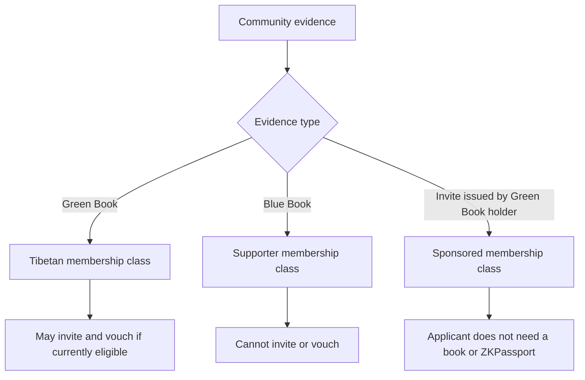
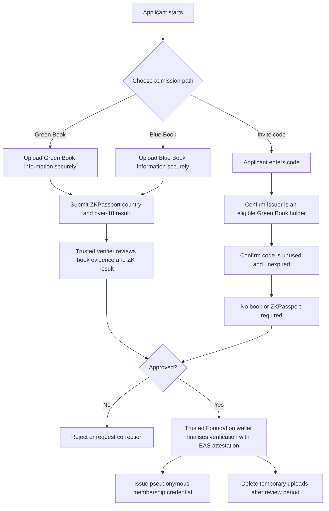
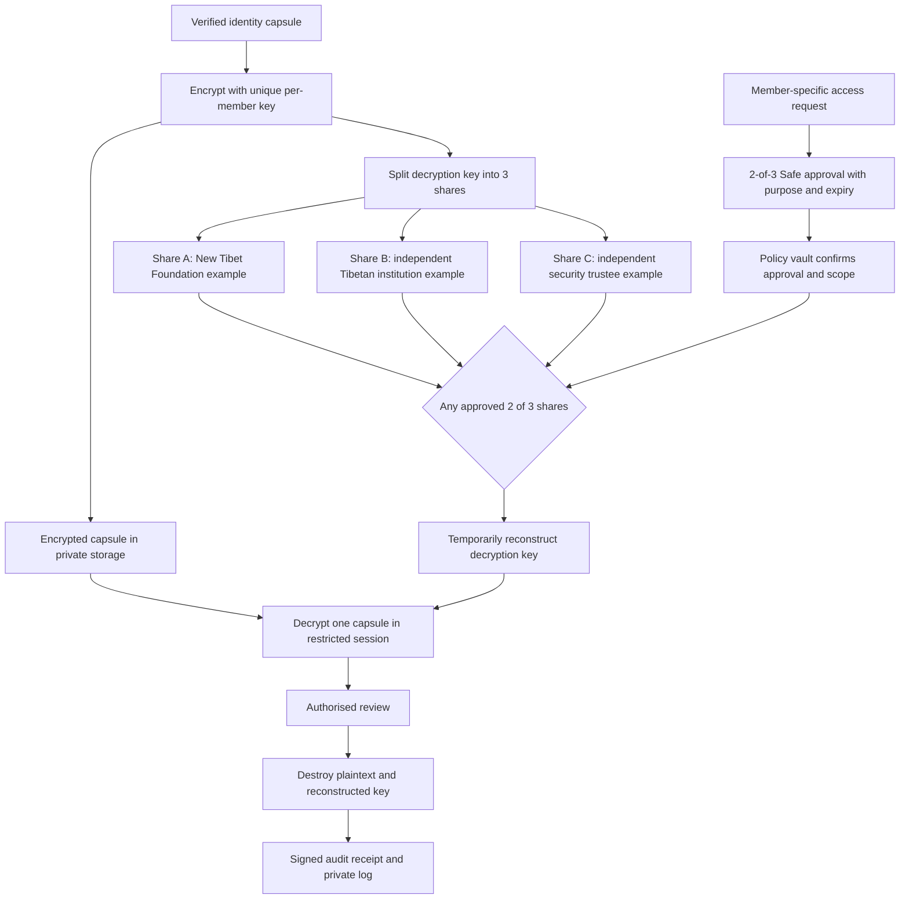
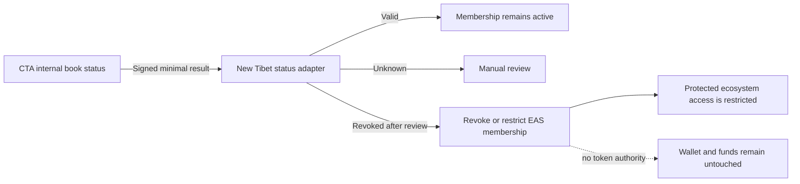
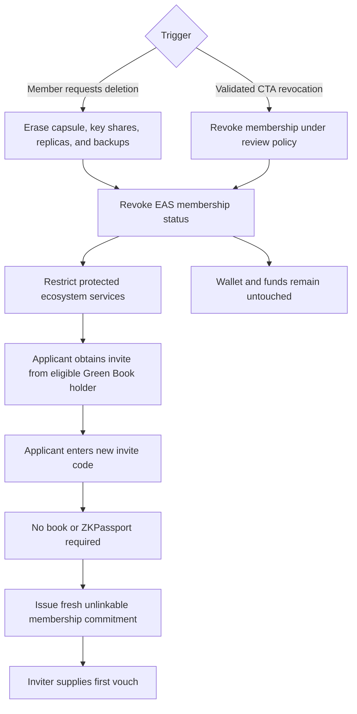

# Tibetan ID

Privacy-preserving membership architecture for the New Tibet ecosystem.

> [!IMPORTANT]
> This is a concept architecture for privacy, legal, governance, and security review. It is not yet a production specification.

## Contents

1. [Green Books and Blue Books](#1-green-books-and-blue-books)
2. [Applicant and verification flows](#2-applicant-and-verification-flows)
3. [Vouches and community standing](#3-vouches-and-community-standing)
4. [The identity capsule](#4-the-identity-capsule)
5. [Onchain records and future CTA integration](#5-onchain-records-and-future-cta-integration)
6. [Exceptional access](#6-exceptional-access)
7. [Deletion, revocation, and re-entry](#7-deletion-revocation-and-re-entry)
8. [Implementation work](#8-implementation-work)
9. [References](#9-references)

## 1. Green Books and Blue Books

The two books represent different relationships with the Tibetan community:

- **Green Book - Tibetans.** The Central Tibetan Administration (CTA) Department of Finance maintains the Green Book system for Tibetans and records voluntary contributions. Its digital portal supports applications and review by a Tibetan Settlement Office and the Department of Finance.
- **Blue Book - Tibetan supporters.** The CTA describes the Blue Book as the Tibetan Solidarity Partnership. Introduced in 1996 and patterned after the Green Book, it records contributions from friends and supporters of Tibet.

Within Tibetan ID:

- a verified Green Book supports the `Tibetan` membership class;
- a verified Blue Book supports the `Supporter` membership class;
- only an eligible Green Book holder may issue an invite or provide a standing vouch; and
- a Blue Book holder cannot invite or vouch for another applicant.

An invite proves sponsorship by a Green Book holder. It does not claim that the invited person holds a Green Book or Blue Book.

## 2. Applicant and verification flows

There are two admission paths.

### 2.1 Green Book or Blue Book path

1. The applicant selects Green Book or Blue Book membership.
2. The applicant uploads the information needed to verify the book through a secure, temporary upload service.
3. The applicant also submits a ZKPassport proof. The retained result contains only:
   - country; and
   - whether the applicant is over 18.
4. A trusted verifier reviews the uploaded book evidence and the ZKPassport result.
5. The verifier approves or rejects the application.
6. Verification may be finalised onchain: a trusted New Tibet Foundation wallet attests through Ethereum Attestation Service (EAS) that the offchain checks passed. Raw uploads and personal data are never written onchain.
7. Source files and temporary proof material are deleted after the approved review and appeal period.
8. The applicant receives a pseudonymous membership credential.

The ZKPassport proof is additional to the Green Book or Blue Book. It does not replace the book. No name, exact date of birth, document number, address, photograph, or raw passport data is retained from ZKPassport.

### 2.2 Green Book holder invitation path

1. An eligible Green Book holder creates a single-use, expiring invite code.
2. An applicant enters the invite code.
3. The service verifies that the code was issued by a currently eligible Green Book holder and has not been used or expired.
4. The applicant does not submit a Green Book, Blue Book, or ZKPassport proof.
5. A trusted verifier or Foundation wallet approves the sponsored membership.
6. The code is consumed and the inviter supplies the applicant's first vouch.
7. The applicant receives a pseudonymous membership credential.

Blue Book holders have no ability to create invite codes.

## 3. Vouches and community standing

Only distinct, currently eligible Green Book holders may vouch for a member. The same holder cannot increase the same member's standing more than once. Blue Book holders cannot vouch.

The proposed maximum of five vouches is only an initial design idea. It is not a permanent protocol rule and could be adjusted later through the agreed governance process. Any change should update the policy version used by the verifier and EAS attestations.

Standing is a community signal. It is not proof of legal identity, control of funds, or permission to access the identity capsule.

## 4. The identity capsule

The identity capsule is a small, encrypted record of why a membership was approved. It is not a document archive.

### 4.1 What it contains

- A random private member identifier that is not an email address or wallet address.
- The membership class: Tibetan, Supporter, or Sponsored.
- The admission path: Green Book, Blue Book, or Green Book holder invite.
- The verification outcome, time, trusted verifier, and policy version.
- For a Green Book or Blue Book applicant, only the ZKPassport country and over-18 result.
- For an invited applicant, a private commitment to the consumed invite and first vouch.
- Commitments to active vouches and the current standing value.
- The current lifecycle state, such as active, restricted, or revoked.

### 4.2 What it does not contain

- Green Book or Blue Book photographs or numbers.
- Passport data, exact date of birth, name, address, or photograph.
- Raw ZKPassport proofs.
- The applicant's ordinary wallet address.
- The original invite code.

The uploaded book information exists only in the temporary verification area. It is not copied into the permanent capsule. If a future legal requirement creates a genuine need for additional personal data, that information should be placed in a separate, purpose-limited encrypted extension with its own deletion date.

### 4.3 Encryption, splitting, and reconstruction

In this design, the secret needed to unlock the data is sharded rather than the plaintext. This avoids placing three copies of personal data with three custodians.

1. A new random encryption key is generated for each capsule.
2. The capsule is encrypted and the ciphertext is placed in private storage.
3. The capsule's decryption key is split into three cryptographic shares. One share alone is useless; any approved two shares can reconstruct the key.
4. Each share is held by a separately governed custodian.
5. Reconstruction is allowed only for one member, one approved purpose, and a short time window.
6. After the session, the reconstructed key and plaintext are destroyed and the access event is logged.

Possible custodians, given only as examples, are:

- **Custodian A:** the New Tibet Foundation or its independently controlled security team;
- **Custodian B:** a separately governed Tibetan cultural, community, or administrative institution; and
- **Custodian C:** an independent professional security trustee, such as a regulated Swiss custody provider or specialist HSM operator.

The final custodians must be legally and operationally independent. No custodian should store the encrypted capsule and enough shares to decrypt it alone.

## 5. Onchain records and future CTA integration

EAS is used as a public integrity and revocation layer, not as an identity database. The trusted Foundation wallet or another authorised verifier may issue attestations.

| EAS record | Public contents |
| --- | --- |
| Membership status | High-entropy member commitment, active/restricted/revoked state, standing, policy version, and a salted capsule commitment |
| Vouch | Member commitment, pairwise voucher nullifier, and policy version |
| Access approval | Random request commitment and expiry |
| Audit anchor | Merkle root of the private access log |
| Deletion receipt | Fresh, non-identifying erasure commitment |

EAS must never contain names, contact details, wallet-to-person mappings, book or passport numbers, images, invite codes, raw ZK proofs, country, age status, or private-storage locations.

### 5.1 Possible future CTA connection

A future integration could allow a New Tibet adapter to receive a signed status from the CTA's internal Green Book or Blue Book system. The response should be limited to an opaque reference and a status such as valid, revoked, or unknown. CTA records should not be copied into New Tibet.

A verified revoked status could cause the corresponding New Tibet membership credential and EAS attestation to be restricted or revoked under the agreed review and appeal rules. This affects membership access only. The adapter must have no role, allowance, or upgrade authority in token, wallet, or treasury contracts, so it cannot freeze, seize, move, or burn funds.

Because public-chain history cannot be erased, all identifying data and the ZKPassport country and over-18 result remain offchain in the encrypted capsule.

## 6. Exceptional access

Access to a capsule requires:

1. a member-specific request with a documented purpose, scope, and expiry;
2. two independent approvals through a dedicated 2-of-3 Safe;
3. validation by a policy-enforcing vault or HSM;
4. two custodians releasing shares into a restricted session;
5. temporary access to one capsule only; and
6. destruction of reconstructed material followed by a signed audit receipt.

EAS records only a random approval commitment and the root of the private audit log. A Safe transaction proves that access was approved, but the policy vault, key controls, and signed logs are needed to prove that the approved scope was enforced.

## 7. Deletion, revocation, and re-entry

An authenticated member may request deletion without a custodian vote or Safe approval. The system closes active sessions, destroys the capsule key and backups, instructs custodians to delete their shares, removes replicas and indexes, and revokes the membership credential.

Member-requested deletion and CTA-triggered membership revocation both restrict services that require active membership, including login, eligibility, voting, governance, and other protected ecosystem functions. Neither action:

- freezes, seizes, moves, burns, or locks funds;
- revokes the member's wallet keys; or
- calls token or treasury contracts.

A CTA-triggered revocation does not automatically erase the capsule; retention and deletion follow the applicable policy and the member's rights.

A deleted or revoked member may re-enter through a new invite from an eligible Green Book holder. A Blue Book holder cannot provide this invite. The returning person does not need to present a Green Book, Blue Book, or ZKPassport proof. Re-entry creates a fresh member secret and commitment, and the inviter provides the first vouch.

## 8. Implementation work

Before launch, the project needs final EAS schemas and resolver rules, executable tests for every admission and revocation path, chain selection, an anonymous credential design, custodian agreements, appeal and recovery policies, retention schedules, a formal threat model, a privacy impact assessment, and independent legal and security reviews.

The proposed five-vouch cap and the choice of custodians remain open design decisions.

## 9. References

- [CTA: Green Book Online Application Portal](https://tibet.net/official-announcement-department-of-finance-launches-green-book-online-application-portal/)
- [CTA: Greenbook Digital Portal](https://greenbook.tibet.net/)
- [CTA: Friends of Tibet and the Blue Book](https://tibet.net/support-tibet/friends-of-tibet/)
- [GitHub documentation: Mermaid diagrams in Markdown](https://docs.github.com/en/get-started/writing-on-github/working-with-advanced-formatting/creating-diagrams)
- [Ethereum Attestation Service contracts](https://github.com/ethereum-attestation-service/eas-contracts)
- [ZKPassport](https://zkpassport.id/)
