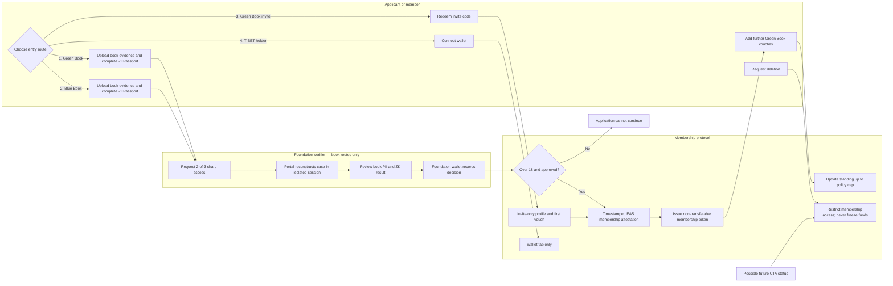
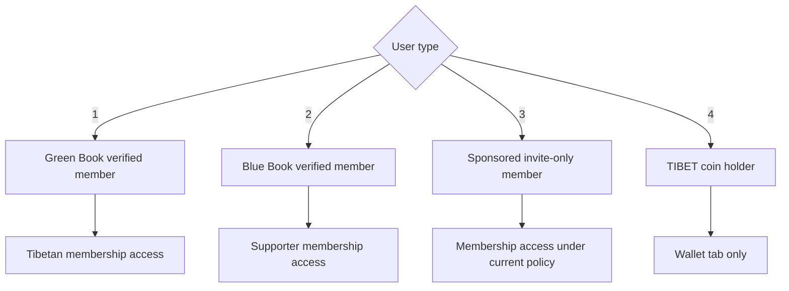
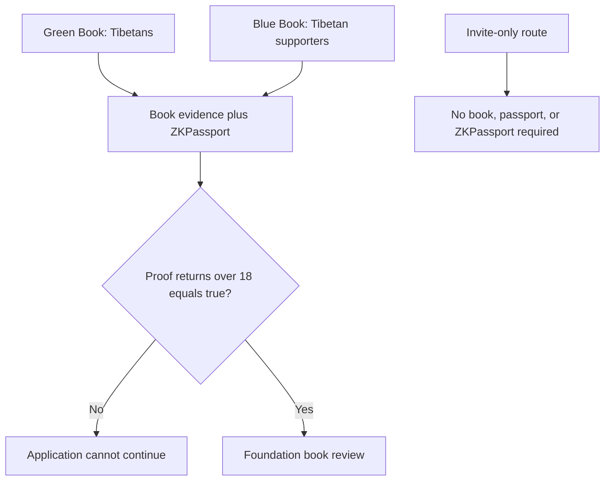
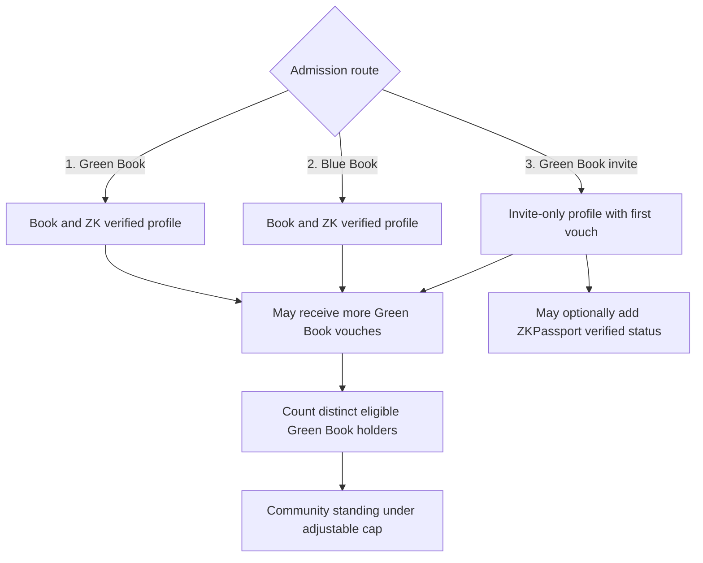
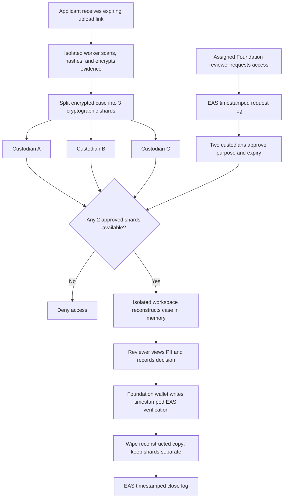
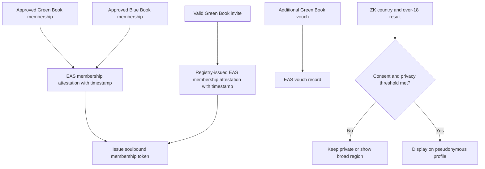
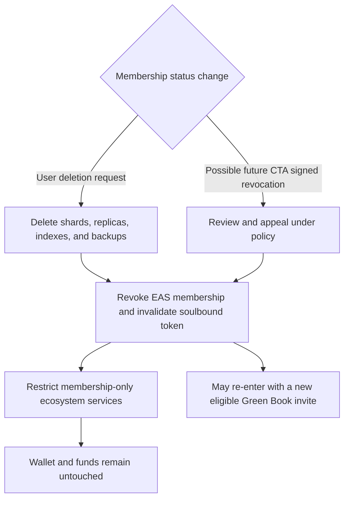

# Tibetan ID

Privacy-preserving membership architecture for the New Tibet ecosystem.

> [!IMPORTANT]
> This is a concept for privacy, legal, governance, and security review—not a production specification. Membership rules and their consequences must ultimately be enforced and tested in application and smart-contract code.

## Master membership flow

**Contents**

1. [User types and access](#1-user-types-and-access)
2. [Books and proof of personhood](#2-books-and-proof-of-personhood)
3. [Admission, vouches, and standing](#3-admission-vouches-and-standing)
4. [Foundation Verification Portal and custody](#4-foundation-verification-portal-and-custody)
5. [Onchain records, token, and public attributes](#5-onchain-records-token-and-public-attributes)
6. [Deletion, revocation, and future CTA integration](#6-deletion-revocation-and-future-cta-integration)

## 1. User types and access

| User type | Entry requirement | Access and limits |
| --- | --- | --- |
| **Green Book verified member** | Green Book evidence, ZKPassport, and Foundation verification | Tibetan membership access; may issue invites and vouch. |
| **Blue Book verified member** | Blue Book evidence, ZKPassport, and Foundation verification | Supporter membership access; cannot issue invites or vouch. |
| **Sponsored member** | Single-use invite from an eligible Green Book holder | Membership access under current policy; profile remains `Invite-only`. |
| **`$TIBET` coin holder** | Connects a wallet holding `$TIBET` | Wallet tab only; no membership areas, voting, directory, invites, or vouching. |

Holding `$TIBET` does not confer membership. Conversely, restricting or deleting membership cannot freeze, move, seize, burn, or lock assets in the user's wallet.

## 2. Books and proof of personhood

The CTA Green Book records voluntary contributions by Tibetans. The Blue Book, or Tibetan Solidarity Partnership, is for friends and supporters of Tibet. Tibetan ID uses these as two different membership bases; this is not a claim of CTA endorsement.

For either book route, ZKPassport is an additional **proof-of-personhood** signal. It checks the cryptographic signature of a supported NFC passport or identity document, reducing the chance of synthetic or AI-generated applicants passing an image-based book process. This is useful because Green and Blue Book systems do not have the same cryptographic document infrastructure as many national passports.

ZKPassport does not prove that a book is genuine or belongs to the passport holder. The Foundation reviewer must still assess the book and bind both checks to one application session. The retained result is limited to:

- proof-of-personhood success;
- country; and
- `over 18 = true`.

No name, birth date, passport number, address, photograph, or raw passport data is retained from ZKPassport. Tibetan ID is an 18+ service: a false, missing, or failed over-18 result stops a ZKPassport-based application.

An invite-only applicant does not need a passport or ZKPassport and instead declares that they are at least 18. This cannot guarantee age, but a later ZKPassport result that fails the over-18 rule prevents continued membership.

## 3. Admission, vouches, and standing

**Book routes**

Green and Blue Book applicants upload evidence, complete the over-18 ZKPassport proof, and pass Foundation review. Approval produces the relevant verification basis: `Green Book verified` or `Blue Book verified`.

**Green Book invitation route**

An eligible Green Book holder creates a single-use, expiring code. The protocol validates and consumes it, creates an `Invite-only` profile, records the first vouch, and issues membership credentials automatically. **The Foundation neither reviews nor approves invitations or vouches.** Blue Book holders cannot issue them.

This gives Tibetans who need anonymity, face political risk, lack a passport, or cannot use NFC documents a route into the ecosystem without uploading book-linked PII. An invite-only member may later add a unique `ZKPassport verified` status through the application or an onchain verifier, without Foundation review. This optional status increases personhood confidence but does not turn the profile into a book-verified profile.

**Community standing**

Green Book verified, Blue Book verified, and invite-only members may add codes from other distinct, eligible Green Book holders. Each accepted code adds one vouch. The profile shows the admission basis, optional ZK status, and vouch count separately; voucher identities and codes remain private.

Five counted vouches is only an initial idea. Governance may adjust or remove the cap, so it must be versioned rather than permanently embedded in the identity.

## 4. Foundation Verification Portal and custody

The **Foundation Verification Portal** is a dedicated, self-hosted case-review application with an applicant upload page, three independently administered shard stores, and an isolated reviewer workspace. It is not the public member application, a cloud drive, or a third-party KYC dashboard.

At ingestion, the portal scans, hashes, encrypts, and splits the submission into three shards, then erases the complete intake copy. A named reviewer using a hardware-backed credential can request a case. Only after two custodians approve may the workspace merge two shards in memory. This is the only point at which the reviewer can see the book PII, file metadata, ZKPassport receipt, tamper warnings, and permitted prior decisions. Closing the case wipes the reconstructed copy; the stored shards remain separate.

The encrypted dossier retains only what is needed to audit the decision: original book evidence; hashes and chain of custody; relevant book fields; the ZK receipt; reviewer decisions; policy version; `submittedAt` and `verifiedAt`; EAS UID; soulbound-token ID; and correction, appeal, or revocation history.

Possible custodians include the Foundation security team, a separately governed Tibetan community institution, and an independent professional security trustee or HSM operator. Each request must identify the case, purpose, scope, and expiry.

Safeguards include view-only watermarked sessions; downloads, printing, clipboard, and export disabled by default; encryption in transit and at rest; independent shard administration; no trackers or model training; fixed retention and tested erasure; and two-person approval for exceptional exports. Every request, approval, reconstruction, decision, export, and closure is timestamped on EAS using high-entropy case commitments—never PII.

## 5. Onchain records, token, and public attributes

Ethereum Attestation Service (EAS) is the public integrity, timestamp, and revocation layer—not the PII database. The Foundation wallet records Green and Blue Book verification. Invite redemption and vouches are participant-signed actions recorded by the membership registry without Foundation approval.

| EAS record | Privacy-minimised contents |
| --- | --- |
| Membership | Member commitment, active/restricted/revoked state, basis, standing, policy version, `verifiedAt`, and attestation time |
| Vouch | Member commitment, pairwise voucher identifier, policy version, and timestamp |
| Portal log | Case commitment, request/approval/open/decision/close event, purpose or verifier commitment, and timestamp |
| Deletion | Fresh, non-identifying erasure commitment |

EAS must never contain PII, book or passport numbers, images, invite codes, raw ZK proofs, dossier locations, or low-entropy hashes of those values.

Each approved book application or valid invite also receives a non-transferable **soulbound membership token** in the chosen membership wallet. It references the current EAS membership attestation and contains no PII, country, or age. Invalidating it affects membership access only, never other wallet assets. Because the token publicly links a wallet to pseudonymous membership, at-risk users should be offered a dedicated-wallet option and warned about blockchain correlation.

Country and the over-18 flag may appear publicly only with separate consent. Exact country should remain hidden until a configurable cohort threshold is met; before then, show a broad region or `Withheld for privacy`. Use delayed batch publication and apply the threshold to combinations such as country, age flag, verification basis, and joining period. By default, EAS stores only a commitment to these attributes so later withdrawal remains meaningful.

## 6. Deletion, revocation, and future CTA integration

An authenticated member may request deletion without a custodian vote. Subject to documented legal-retention exceptions, the service closes sessions, erases dossier shards and backups, removes indexes, revokes the EAS membership, and invalidates the soulbound token. This restricts membership-only parts of the Tibetan ecosystem but does not freeze or affect funds.

A future adapter might receive a minimal signed `valid`, `revoked`, or `unknown` status from the CTA's internal Green or Blue Book system. It should copy no CTA records. A confirmed revocation could restrict membership after review and appeal, but the adapter must have no permission in token, wallet, or treasury contracts.

A deleted or revoked person may return through a new invite from an eligible Green Book holder. They need no book, passport, or ZKPassport for that route; the new profile is `Invite-only` and begins with the inviter's vouch. Blue Book holders cannot provide the invite.

Before launch, the code and tests must demonstrate the over-18 gate, book-only Foundation authority, Foundation-free invites and vouches, 2-of-3 reconstruction, timestamped EAS events, soulbound-token invalidation, privacy thresholds, erasure, re-entry, and non-interference with funds.

Sources: [CTA Green Book portal](https://greenbook.tibet.net/), [CTA Blue Book background](https://tibet.net/support-tibet/friends-of-tibet/), [ZKPassport](https://zkpassport.id/), [EAS contracts](https://github.com/ethereum-attestation-service/eas-contracts), and [GitHub Mermaid support](https://docs.github.com/en/get-started/writing-on-github/working-with-advanced-formatting/creating-diagrams).
