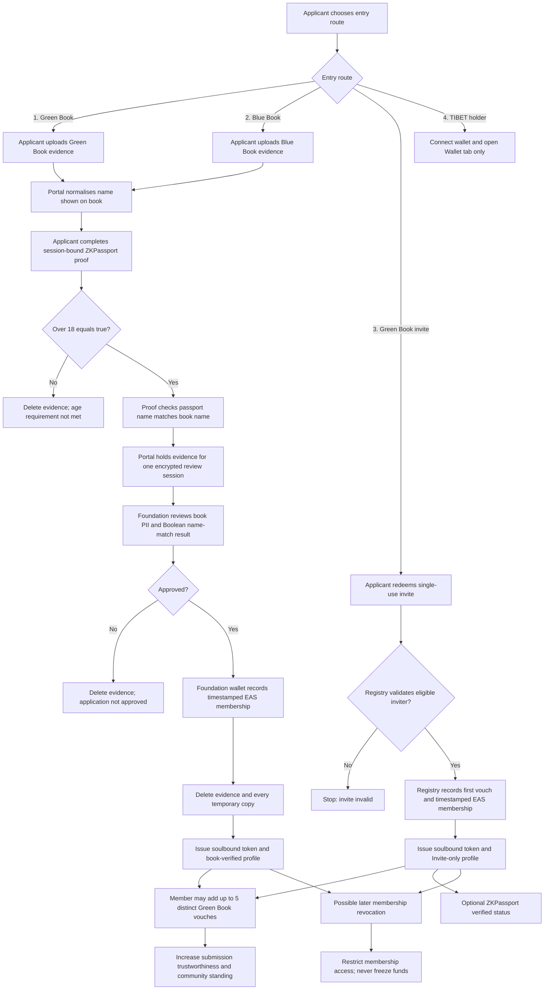
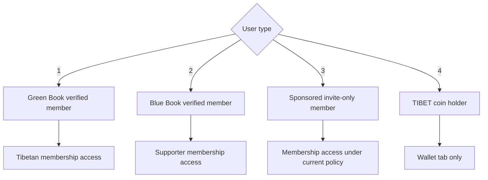
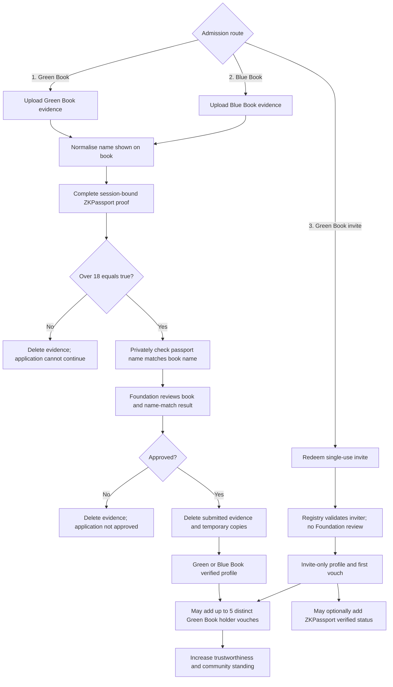
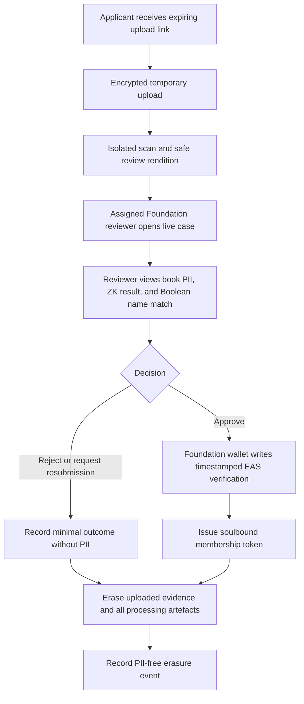
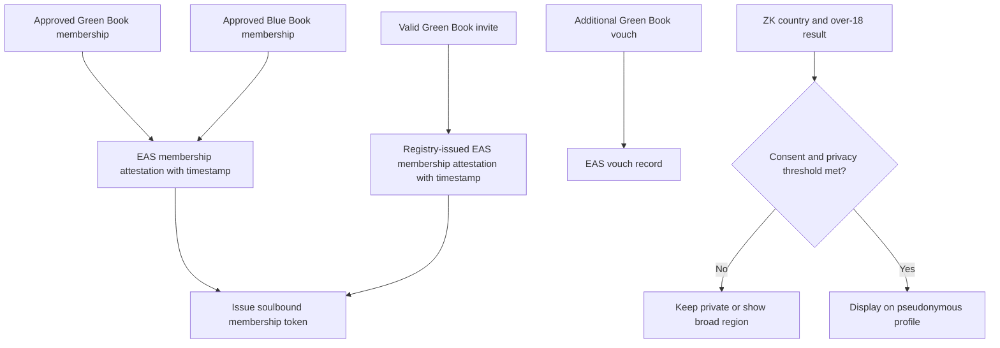
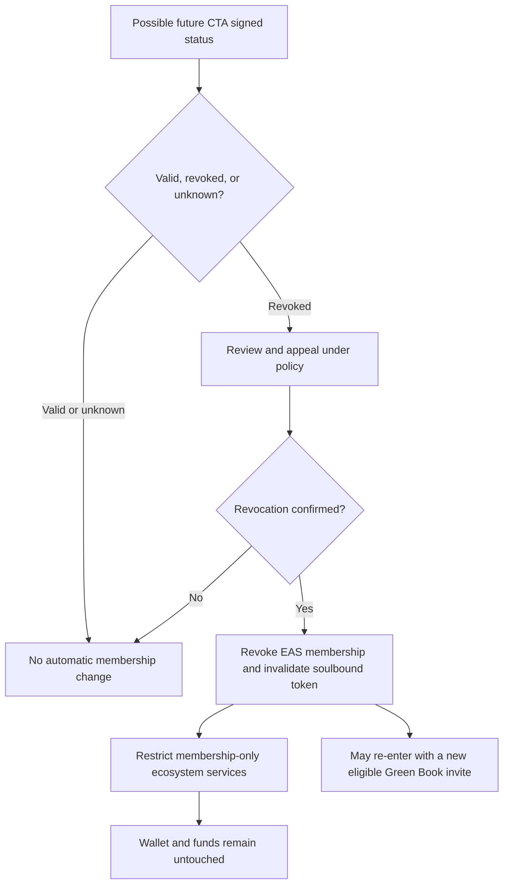

# Tibetan ID

Privacy-preserving membership architecture for the New Tibet ecosystem.

> [!IMPORTANT]
> This is a concept for privacy, legal, governance, and security review—not a production specification. Membership rules and their consequences must ultimately be enforced and tested in application and smart-contract code.

## Master membership flow

**Contents**

1. [User types and access](#1-user-types-and-access)
2. [Books, admission, and community standing](#2-books-admission-and-community-standing)
3. [Foundation Verification Portal and deletion](#3-foundation-verification-portal-and-deletion)
4. [Onchain records, token, and public attributes](#4-onchain-records-token-and-public-attributes)
5. [Revocation and future CTA integration](#5-revocation-and-future-cta-integration)

## 1. User types and access

| User type | Entry requirement | Access and limits |
| --- | --- | --- |
| **Green Book verified member** | Green Book evidence, ZKPassport, and Foundation verification | Tibetan membership access; may issue invites and vouch. |
| **Blue Book verified member** | Blue Book evidence, ZKPassport, and Foundation verification | Supporter membership access; cannot issue invites or vouch. |
| **Sponsored member** | Single-use invite from an eligible Green Book holder | Membership access under current policy; profile remains `Invite-only`. |
| **`$TIBET` coin holder** | Connects a wallet holding `$TIBET` | Wallet tab only; no membership areas, voting, directory, invites, or vouching. |

Holding `$TIBET` does not confer membership. Conversely, restricting or revoking membership cannot freeze, move, seize, burn, or lock assets in the user's wallet.

## 2. Books, admission, and community standing

The CTA Green Book records voluntary contributions by Tibetans. The Blue Book, or Tibetan Solidarity Partnership, is for friends and supporters of Tibet. Tibetan ID uses these as two different membership bases; this is not a claim of CTA endorsement.

For either book route, ZKPassport is an additional **proof-of-personhood** signal. It checks a supported NFC passport or identity document, reducing the chance of synthetic or AI-generated applicants passing an image-based book process. Green and Blue Book systems lack the cryptographic document infrastructure of many national passports.

ZKPassport does not prove that a book is genuine. The Foundation must still assess it and bind both checks to one application session. The proof discloses only:

- proof-of-personhood success;
- whether the passport name matches the name provided from the book;
- country; and
- `over 18 = true`.

The portal normalises the name shown on the uploaded book and binds its private commitment to the ZKPassport session. The proof checks it against the signed passport name and returns only a Boolean match result. The reviewer confirms that the committed value came from the displayed book. Neither name is published or retained. Name order, spacing, diacritics, and Tibetan transliteration require documented normalization and a manual step-up path rather than automatic rejection.

This private equality check and its normalization rules must be implemented and independently audited in the chosen ZKPassport integration before launch.

No name, birth date, passport number, address, photograph, or raw passport data is received from ZKPassport. The proof is deleted after review; country or over-18 status remains only when separately consented for public display. A false, missing, or failed over-18 result stops the application.

An invite-only applicant does not need a passport or ZKPassport and instead declares that they are at least 18. This cannot guarantee age, but a later ZKPassport result that fails the over-18 rule prevents continued membership.

**Book routes**

Green and Blue Book applicants complete the ZK proof and Foundation review. Approval creates the relevant verified profile; all book evidence and working copies are then deleted.

**Green Book invitation route**

An eligible Green Book holder creates a single-use, expiring code. The protocol validates and consumes it, creates an `Invite-only` profile, records the first vouch, and issues membership credentials automatically. **The Foundation neither reviews nor approves invitations or vouches.** Blue Book holders cannot issue them.

This gives Tibetans who need anonymity, face political risk, lack a passport, or cannot use NFC documents a route into the ecosystem without uploading book-linked PII. An invite-only member may later add a unique `ZKPassport verified` status through the application or an onchain verifier, without Foundation review. This optional status increases personhood confidence but does not turn the profile into a book-verified profile.

**Community standing**

Green Book verified, Blue Book verified, and invite-only members may add codes from other distinct, eligible Green Book holders. Each accepted code adds one vouch and increases the trustworthiness of the original submission or invite-based profile. The profile shows the admission basis, optional ZK status, and vouch count separately; voucher identities and codes remain private.

The current design counts a maximum of five distinct Green Book-holder vouches. This limit is a policy value that governance may adjust later, not a permanent identity claim.

## 3. Foundation Verification Portal and deletion

The **Foundation Verification Portal** is a self-hosted, one-time review application with expiring uploads, temporary encrypted storage, and an isolated workspace—not a public application, cloud drive, evidence archive, or third-party KYC service.

The applicant uses an expiring link. Processing and malware scanning remain inside the controlled environment. A named reviewer with a hardware-backed credential sees only their assigned live case: the book, relevant metadata, ZKPassport result including the Boolean name match, and tamper warnings.

After the decision, the portal deletes the upload, review rendition, extracted fields, thumbnails, scan artefacts, temporary volumes, queue payloads, caches, and recoverable working copies. It retains no book numbers, images, screenshots, raw ZK proofs, evidence hashes, or free-text notes. There is no evidence backup or long-lived bucket versioning; deletion propagates to replicas and failed-job storage.

Only the membership result remains: verification basis, policy version, `verifiedAt`, EAS UID, token ID, and separately consented public ZK attributes. A random erasure reference may confirm deletion but is not derived from the evidence. Disputes or later suspicions require a fresh submission because the original material cannot be reopened.

Safeguards include watermarked view-only sessions; no download, print, clipboard, or export; encryption in transit and temporary storage; automatic expiry; no trackers, external scanning, or model training; PII-redacted logs; and tested erasure. Request, decision, and erasure events use timestamped random commitments, never PII.

Evidence retention or threshold custody may be reconsidered if the Foundation later has the staff, funding, legal basis, independent custodians, and security operations to run it safely. Current resources do not, so no verification evidence survives the initial decision.

## 4. Onchain records, token, and public attributes

Ethereum Attestation Service (EAS) is the public integrity, timestamp, and revocation layer—not the PII database. The Foundation wallet records Green and Blue Book verification. Invite redemption and vouches are participant-signed actions recorded by the membership registry without Foundation approval.

| EAS record | Privacy-minimised contents |
| --- | --- |
| Membership | Member commitment, active/restricted/revoked state, basis, standing, policy version, `verifiedAt`, and attestation time |
| Vouch | Member commitment, pairwise voucher identifier, policy version, and timestamp |
| Portal log | Random case commitment, request/decision/erasure event, policy version, and timestamp |

EAS must never contain PII, book or passport numbers, images, invite codes, raw ZK proofs, evidence-storage locations, or low-entropy hashes of those values.

Each approved book application or valid invite also receives a non-transferable **soulbound membership token** in the chosen membership wallet. It references the current EAS membership attestation and contains no PII, country, or age. Invalidating it affects membership access only, never other wallet assets. Because the token publicly links a wallet to pseudonymous membership, at-risk users should be offered a dedicated-wallet option and warned about blockchain correlation.

Country and the over-18 flag may appear publicly only with separate consent. Exact country should remain hidden until a configurable cohort threshold is met; before then, show a broad region or `Withheld for privacy`. Use delayed batch publication and apply the threshold to combinations such as country, age flag, verification basis, and joining period. By default, EAS stores only a commitment to these attributes so later withdrawal remains meaningful.

## 5. Revocation and future CTA integration

After verification, only the privacy-minimised onchain membership record and token status remain. Later status changes therefore concern revocation rather than offchain evidence management.

A future adapter might receive a minimal signed `valid`, `revoked`, or `unknown` status from the CTA's internal Green or Blue Book system. It should copy no CTA records. A confirmed revocation could restrict membership after review and appeal, but the adapter must have no permission in token, wallet, or treasury contracts.

A revoked person may return through a new invite from an eligible Green Book holder. They need no book, passport, or ZKPassport for that route; the new profile is `Invite-only` and begins with the inviter's vouch. Blue Book holders cannot provide the invite.

Before launch, the code and tests must demonstrate the over-18 gate, private session-bound name matching and normalization, book-only Foundation authority, Foundation-free invites and vouches, the five-vouch cap, automatic evidence erasure including failure paths, timestamped EAS events, soulbound-token invalidation, privacy thresholds, re-entry, and non-interference with funds.

Sources: [CTA Green Book portal](https://greenbook.tibet.net/), [CTA Blue Book background](https://tibet.net/support-tibet/friends-of-tibet/), [ZKPassport](https://zkpassport.id/), [EAS contracts](https://github.com/ethereum-attestation-service/eas-contracts), and [GitHub Mermaid support](https://docs.github.com/en/get-started/writing-on-github/working-with-advanced-formatting/creating-diagrams).
